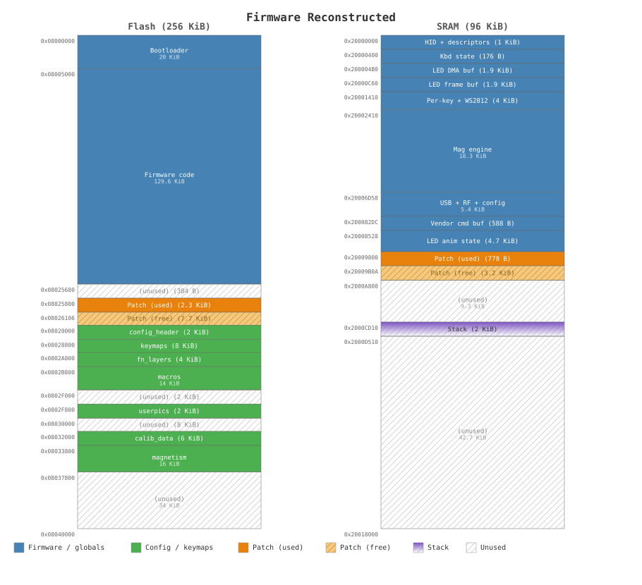
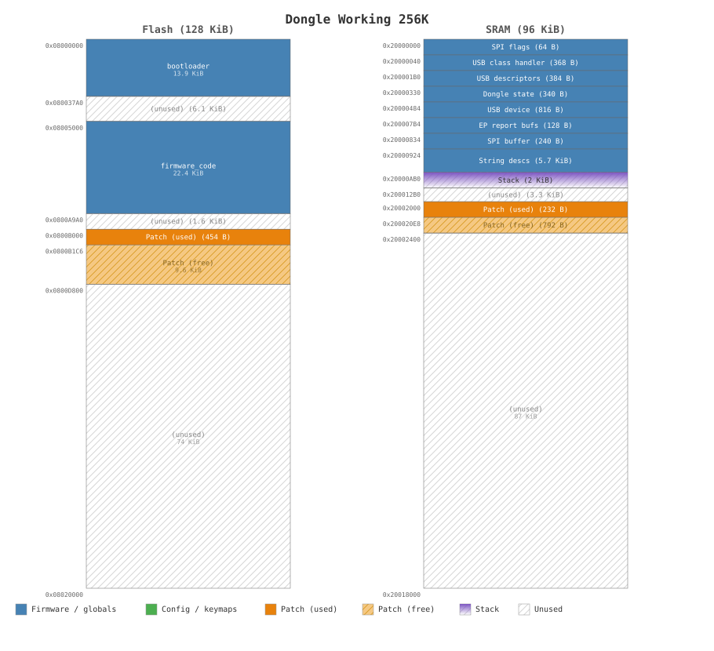

# Firmware Patches

Custom firmware patches for the MonsGeek M1 V5 keyboard and its 2.4GHz wireless dongle. These are binary patches applied on top of the stock RongYuan firmware — no source code required.

## What the patches do

### Keyboard patch (MONSMOD)

- **Battery over USB HID** — Exposes battery level (0–100%) and charging status as a standard HID power supply. Desktop environments (KDE, GNOME) show battery in the system tray automatically.
- **LED streaming** — Per-key RGB control from the host. The driver can push GIF animations frame-by-frame to the keyboard LEDs at ~30fps.
- **Animation engine** — On-device keyframe animation with 8 concurrent definitions, per-key phase offsets, and integer easing (Hold/Linear/InQuad/OutQuad/InOutQuad/InExpo/OutExpo). The daemon sends a compact animation definition once; firmware ticks it autonomously at ~100Hz. Eliminates USB streaming overhead for LED notifications.
- **Debug log** — Ring buffer readable over HID for diagnostics (developer use).
- **RTT telemetry** — SEGGER RTT channel for live battery ADC/charger monitoring over SWD (developer use).
- **Consumer control fix** — Reroutes encoder consumer data to the correct RF sub-type for dongle mode, and NOPs the stock firmware's premature buffer zeroing so consumer data survives until transmission. See [consumer_report_dongle_misroute](bugs/consumer_report_dongle_misroute.txt).
- **Depth monitor unlock** — Enables magnetism depth reports on USB and 2.4GHz (stock limits to Bluetooth only, and blocks 8KHz polling rates). See [depth_report_speed_gate_bug](bugs/depth_report_speed_gate_bug.txt).

### Dongle patch (MONSDON)

- **Battery over USB HID** — Same standard HID battery as the keyboard patch, but for the wireless path. The dongle already caches the keyboard's battery level from RF packets — this patch exposes it to the host via HID descriptors.
- **Proactive updates** — Pushes battery changes to the host as HID Input reports whenever the value changes, so the desktop battery indicator updates without polling.
- **Consumer control fix** — Fixes volume knob and consumer keys over 2.4GHz (stock firmware misroutes them). See [consumer_report_dongle_misroute](bugs/consumer_report_dongle_misroute.txt).
- **Speed gate fix** — NOPs a USB speed check that silences all non-keyboard HID reports. See [depth_report_speed_gate_bug](bugs/depth_report_speed_gate_bug.txt).
- **Patch discovery** — Responds to HID Feature Report ID 8 on IF1 with patch identity (name, version, capabilities), allowing the driver to distinguish dongle patch info from keyboard patch info.

### What stays the same

All stock firmware features continue to work: key scanning, LED effects, macros, magnetism calibration, wireless, Bluetooth, the MonsGeek web configurator — everything. The patches only add new capabilities in unused flash/SRAM space.

## User guide

### Battery level

After flashing the patched firmware, battery level appears automatically in your desktop environment — no driver or BPF loader needed.

**Check it works:**
```bash
# Should show a hid-*-battery entry
ls /sys/class/power_supply/

# Read battery percentage
cat /sys/class/power_supply/hid-*-battery/capacity

# Read charging status
cat /sys/class/power_supply/hid-*-battery/status
# → "Charging" or "Discharging"
```

**KDE**: Battery appears in the system tray power menu alongside laptop battery.
**GNOME**: Appears in Settings → Power, and in the top bar if `gnome-shell-extension-battery-percentage` is installed.

### LED streaming

Requires the `iot_driver` CLI with a patched keyboard (wired USB only):

```bash
# Stream a GIF to the keyboard
iot_driver stream cat.gif

# One-LED-at-a-time test pattern
iot_driver stream-test
```

LED streaming temporarily overrides the current LED effect. The built-in effect resumes when streaming stops.

### Animation engine

The notification daemon programs keyframe animations directly on the keyboard. No continuous USB traffic — the firmware evaluates animations at ~100Hz.

```bash
# Start the notification daemon (D-Bus server)
iot_driver notify-daemon

# Send a notification (from another terminal)
iot_driver notify Esc breathe --var color=cyan
iot_driver notify "text:hello" typewriter --var stagger=150 --var color=red
iot_driver notify frow police

# Query firmware animation state
iot_driver anim-status
```

Effects are defined in `~/.config/monsgeek/effects.toml`. Built-in presets: breathe, flash, pulse, solid, police, rainbow, typewriter, build-status.

The TUI's Notify tab provides live visualization: per-def brightness sparklines (interpolated at 60fps), key assignments with phase offsets, and on-device preview via `p`.

### Patch detection

The driver auto-detects patched firmware:

- **Keyboard**: 0xE7 vendor command (relayed through dongle if wireless)
- **Dongle**: HID Feature Report ID 8 on IF1 (direct, no relay needed)

```bash
iot_driver info
# → Patch:  MONSMOD v1 [battery, led_stream, debug_log, consumer_fix]
# → Dongle: MONSDON v1 [battery, consumer_redirect, speed_gate_nop]

# On stock firmware:
# → Patch: Stock firmware (no patch support).
```

## Comparison: firmware patch vs eBPF

There are two approaches to getting battery level on Linux. They solve the same problem differently.

| | Firmware patch | HID-BPF (akko-loader) |
|---|---|---|
| **What it does** | Adds battery HID descriptor to firmware | Injects battery descriptor via kernel eBPF |
| **Requires flashing** | Yes (one-time) | No |
| **Charging status** | Yes | No (not available via vendor protocol) |
| **Proactive updates** | Yes (Input reports on change) | No (polled on sysfs read) |
| **Kernel version** | Any | 6.12+ (HID-BPF struct_ops) |
| **Root required** | No (after flash) | Yes (BPF load) |
| **Works on** | Wired + dongle | Dongle only |
| **Latency** | Instant (kernel event) | ~100ms (F7 query + poll loop) |

**Recommendation**: Use the firmware patch if you're comfortable flashing. Use BPF if you want a non-invasive solution that doesn't modify the device.

Both can coexist — the firmware patch takes priority since the kernel sees the native HID battery descriptor and doesn't need BPF intervention.

### HID-BPF setup (no firmware modification)

```bash
# Build
make bpf

# Load (requires root, kernel 6.12+)
sudo akko-loader load

# Auto-load on device connect
sudo make install-all
```

See the main [README](../README.md#hid-bpf-battery-support-kernel-612) for full BPF instructions.

## Building the patches

### Prerequisites

```bash
# ARM cross-compiler
sudo apt install gcc-arm-none-eabi    # Debian/Ubuntu
sudo pacman -S arm-none-eabi-gcc      # Arch

# Python 3 (for hook framework)
# No pip packages needed
```

### Keyboard patch

```bash
cd firmwares/2949-v407/patch/

# Build hook binary
make

# Apply to firmware image
make patch

# Flash via driver
cd ../../../iot_driver_linux
cargo run --release -- firmware flash -y ../firmwares/2949-v407/firmware_patched.bin
```

### Dongle patch

```bash
cd firmwares/DONGLE_RY6108_RF_KB_V903/patch/

# Build hook binary
make

# Apply to firmware image
make patch

# Flash via driver (enters DFU automatically)
cd ../../../iot_driver_linux
cargo run --release -- firmware flash --dongle -y \
  ../firmwares/DONGLE_RY6108_RF_KB_V903/dfu_dumps/dongle_patched_256k.bin
```

**Note**: The dongle can also be flashed via the AT32F405's built-in ROM DFU bootloader (BOOT0 pin). See [HARDWARE.md](HARDWARE.md) for BOOT0 pad location and DFU recovery procedure.

## Technical reference

### Architecture

```
patch/                          Shared code (repo root)
├── hook_framework.py           Trampoline generator + binary patcher
├── hid_desc.h                  HID descriptor macros
└── at32f405_sdk/               Artery BSP headers (CMSIS + peripherals)

firmwares/2949-v407/patch/      Keyboard patch
├── hooks.py                    Hook definitions + binary patch addresses
├── handlers.c                  C handler implementations
├── handlers.S                  Asm glue (memcpy, EP2 transmit wrapper)
├── patch.ld                    Linker script (PATCH flash + PATCH_SRAM)
├── fw_v407.h                   Auto-generated firmware symbols (from Ghidra)
├── fw_symbols.ld               Auto-generated linker symbols
└── Makefile

firmwares/DONGLE_.../patch/     Dongle patch (same structure)
├── hooks.py
├── handlers.c
├── ...
```

### How hooks work

The hook framework (`hook_framework.py`) implements binary patching via ARM Thumb-2 trampolines:

1. **Displacement**: The first N bytes of the target function are copied to a stub in the patch zone.
2. **Trampoline**: A `B.W` (branch) instruction overwrites the target's prologue, redirecting to the stub.
3. **Stub**: The stub calls the C handler, then either falls through to the displaced prologue + jumps back (before/filter modes), or skips the original function (if filter returns non-zero).

Hook modes:
- **before**: Handler runs before the original function. Always falls through.
- **filter**: Handler returns 0 (passthrough) or non-zero (intercepted, original skipped).

### Keyboard patch details



**Flash layout** (patch zone):
```
0x08025800 - 0x08027FFF   Patch zone (10KB, unused in stock firmware)
```

**SRAM layout**:
```
0x20009800 - 0x20009BFF   PATCH_SRAM (4KB, 47% used)
  - RTT control block (pinned at start via .rtt section)
  - extended_rdesc buffer (217 bytes)
  - Debug log ring buffer (512 bytes)
  - Diagnostic counters
  - Animation engine: 8 defs × 56B, 82 key assignments × 2B, overlay buf 246B
```

**Hooks** (5 total):

| Hook | Target | Mode | Purpose |
|------|--------|------|---------|
| `vendor_dispatch` | `vendor_command_dispatch` (0x08013304) | filter | Intercepts 0xE7/0xE8/0xE9/0xEA/0xEB/0xEC vendor commands |
| `hid_class_setup` | `hid_class_setup_handler` (0x0801474C) | filter | Intercepts GET_REPORT for battery Feature report (ID 7) |
| `usb_connect` | `usb_otg_device_connect` (0x08018690) | filter | Patches descriptors + inits RTT before USB enumeration |
| `battery_monitor` | `battery_level_monitor` (0x0801695C) | before | Emits RTT telemetry for ADC/battery debugging |
| `dongle_reports` | `build_dongle_reports` (0x080174C0) | before | Consumer auto-release + RTT bitmap telemetry |

**Binary patches** (applied at build time):

| Address | What | Description |
|---------|------|-------------|
| 0x0801485C | Literal pool | IF1 rdesc pointer → `extended_rdesc` in PATCH_SRAM |
| 0x080147FC, 0x08014800 | CMP/MOV | IF1 rdesc length cap: 171 → 217 |
| 0x0801282A | 4× NOP | Depth monitor: remove 8KHz polling rate gate |
| 0x08012836 | 4× NOP | Depth monitor: remove Bluetooth-only gate |
| 0x080124FA | 7× NOP | Consumer fix: NOP `hid_report_check_send` block 3's premature buffer zeroing |

**Battery HID descriptor** (46 bytes appended to IF1):
- Report ID 7, Feature + Input reports
- Battery Strength (Usage Page 0x06, Usage 0x20): 0–100%
- Charging (Usage Page 0x85, Usage 0x44): 0/1

### Dongle patch details



**Flash layout**:
```
0x0800B000 - 0x0800D7FF   Patch zone (10KB)
```

**SRAM layout**:
```
0x20002000 - 0x200023FF   PATCH_SRAM (1KB)
  - extended_rdesc buffer (217 bytes)
  - Static report buffers (battery, patch discovery)
```

**Hooks** (3 total, ~514 bytes):

| Hook | Target | Mode | Purpose |
|------|--------|------|---------|
| `usb_init` | `usb_init` (0x080069D8) | before | Populates extended_rdesc before USB enumeration |
| `hid_class_setup` | `hid_class_setup_handler` (0x080071B4) | filter | Battery (Report ID 7) + patch discovery (Report ID 8); patches descriptors |
| `rf_packet_dispatch` | `rf_packet_dispatch` (0x080059FC) | before | Battery change notifications via EP2 Input reports |

**Binary patches** (applied at build time):

| Address | What | Description |
|---------|------|-------------|
| 0x080073C8 | Literal pool | IF1 rdesc pointer → `extended_rdesc` in PATCH_SRAM |
| 0x080072C6, 0x080072CA | CMP/MOV | IF1 rdesc length cap: 171 → 217 |
| 0x08006A34 | 2× NOP | Speed gate: NOP USB Full-Speed-only check in `rf_tx_handler` |

**Consumer control fix** — The consumer redirect is a two-sided fix:
1. Keyboard side: `dongle_reports` hook reroutes encoder data to sub=3 (consumer sub-type) instead of sub=1 (keyboard)
2. Dongle side: stock firmware now handles sub=3 → consumer_ready → EP2 natively (with speed gate NOP'd)

**Key differences from keyboard patch**:
- Setup packet is a separate parameter (r1), not embedded in udev struct
- Uses OTGHS (not OTGFS1), `g_usb_device` at 0x20000484 (no +4 offset)
- Battery data comes from `dongle_state.kb_battery_info` (+0xDB) and `.kb_charging` (+0xDC), cached from RF packets
- No vendor command dispatch — 0xE7/0xE8/0xE9 queries relay through the dongle to the keyboard

### Patch discovery protocol

Both patches expose their identity for driver auto-detection:

**Keyboard** — 0xE7 vendor command (via SET_REPORT/GET_REPORT on IF2):

| Offset | Field | Description |
|--------|-------|-------------|
| 1–2 | Magic | 0xCA 0xFE |
| 3 | Version | Patch version (currently 1) |
| 4–5 | Capabilities | Bitmask (LE16), see table below |
| 6–13 | Name | NUL-padded ASCII ("MONSMOD") |
| 14+ | Diagnostics | HID setup call counts, last setup packet, battery level, ADC values |

**Dongle** — HID Feature Report ID 8 (via GET_FEATURE on IF1):

| Offset | Field | Description |
|--------|-------|-------------|
| 0 | Report ID | 0x08 |
| 1–2 | Magic | 0xCA 0xFE |
| 3 | Version | Patch version (currently 1) |
| 4–5 | Capabilities | Bitmask (LE16), see table below |
| 6–13 | Name | NUL-padded ASCII ("MONSDON") |

The dongle uses a HID Feature report instead of a vendor command because 0xE7 is forwarded through to the keyboard — there's no way to intercept it dongle-side.

**Capability bits** (shared bitmask format):

| Bit | Name | Keyboard | Dongle |
|-----|------|----------|--------|
| 0 | `battery` | HID battery descriptor + GET_REPORT | HID battery via dongle_state cache |
| 1 | `led_stream` | Per-key RGB streaming (0xE8) | — |
| 2 | `debug_log` | Ring buffer debug log (0xE9) | — |
| 3 | `consumer_fix` | Encoder data rerouted to sub=3 | — |
| 4 | `consumer_redirect` | — | Sub=3 consumer → EP2 (native path) |
| 5 | `speed_gate_nop` | — | USB speed check NOPd |
| 6 | `anim_engine` | On-device animation engine (0xEA) | — |
| 7 | `peek_poke` | Memory read/write for debugging (0xEB/0xEC) | — |

Current values: MONSMOD = 0x00CF, MONSDON = 0x0031.

### Peek / poke

`iot_driver peek` and `poke` read and write memory over the vendor channel, so state can be inspected on a running keyboard without an SWD probe. The firmware side is `patch/memaccess.h` (shared by the v407 and v408 builds, which share `handlers.c`); the wire format and the address whitelist are in [PROTOCOL.md](PROTOCOL.md#peek-0xeb--poke-0xec).

The handlers are plain C with a swappable memory backend, so they are tested on the host without hardware:

```bash
make -C patch test     # address whitelist, reply layout, every refusal, request vectors shared with the Rust driver
```

Firmware that predates this has no `peek_poke` capability; the CLI checks and says so rather than sending a command the old firmware would ignore.

### Symbol export pipeline

Firmware symbols (function addresses, globals, struct types) are extracted from Ghidra and used at compile time:

```
Ghidra Server repository "monsgeek" (latest checked-in version)
  → scripts/ghidra_export_symbols.sh (analyzeHeadless, read-only)
    → ExportSymbols.java
      → symbols.json
        → generate_patch_files.py
          → fw_v407.h (C header with externs + struct typedefs)
          → fw_symbols.ld (linker symbols for firmware functions/globals)
          → patch.ld (memory regions + sections)
```

The Ghidra Server repository is the source of truth; the old local `ghidra_v407` project is no longer read. The export uses the credentials in `~/.config/ghidra-mcp/server.env` (`GHIDRA_SERVER_HOST`/`_PORT`/`_USER`/`_PASSWORD`, the file the `ghidra-headless@` services use; override with `GHIDRA_SERVER_ENV`). It opens the program read-only, so it cannot modify the repository.

**Important**: Never edit `fw_v407.h` or `fw_symbols.ld` manually. Update labels/types in Ghidra first and **check the program in** (the export reads the checked-in version, not your working copy), then run `make generate` in `patch/` (it re-exports every time).

### Recovery

If a patched firmware causes issues:

**Keyboard**: Enter ROM DFU (bridge BOOT0 to 3.3V), flash stock firmware via `dfu-util`, or use `iot_driver firmware flash` with the stock `.bin`.

**Dongle**: Same ROM DFU procedure (BOOT0 pad on dongle PCB). Flash the unmodified `dongle_working_256k.bin`.

**Factory reset** (config only, preserves firmware): Write 2KB of 0xFF to config region:
```bash
# Keyboard
dfu-util -a 0 -d 2e3c:df11 --dfuse-address 0x08028000 -D /dev/zero --upload-size 2048

# Or just re-flash stock firmware — bootloader erases config automatically
```

See [HARDWARE.md](HARDWARE.md) for BOOT0 pad locations and full DFU recovery procedure.
